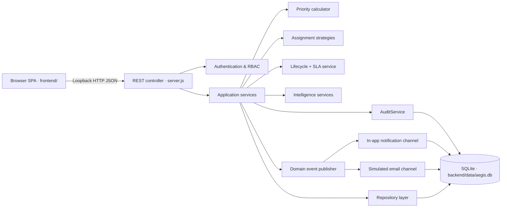

# AEGIS system architecture

## Architectural style

AEGIS uses a deliberately small **layered monolith**. It is easier to run and defend in a semester project than a distributed system, while still separating responsibilities:

## Responsibilities

| Layer | Responsibility | Must not do |
| --- | --- | --- |
| Browser SPA | Route views, render API data, client-side form feedback, accessible interactions | Decide authorization, create artificial dashboard values, or bypass business rules |
| HTTP controller | Parse request, authenticate session, authorize role, validate DTO shape, map domain errors to HTTP | Embed lifecycle/SLA/assignment algorithms |
| Application service | Coordinate a use case within a transaction: create, assign, acknowledge, investigate, resolve, verify, close | Know DOM/UI details |
| Domain policies | Priority, assignment, lifecycle, duplicate matching, categorisation, SLA risk/escalation | Perform raw HTTP or direct UI work |
| Event subscribers | Persist audit entries; produce in-app/outbox notifications | Change an incident silently without service validation |
| Repository | Isolate SQL and row mapping | Make permission/business-rule decisions |

## Security boundary

1. `POST /api/auth/register` creates **employees only**.
2. Privileged user creation is admin-only.
3. Passwords are never stored as plaintext: Node crypto derives a salted password hash.
4. Login returns an opaque bearer token. SQLite stores its SHA-256 hash and expiration. The browser uses local storage for this local demonstration. `GET /api/auth/me` returns a public user DTO.
5. Every non-public request resolves the session and checks the caller's role and incident ownership before it calls a service.
6. Validation and domain exceptions produce controlled JSON errors, not stack traces.

## Data and transaction policy

SQLite is file-backed, so the database survives server restarts. Timestamps are generated by the server in UTC. A multi-step incident operation should either write its incident, assignment/SLA state, audit event, and notification events together or fail without a partial incident. Historical audit, breach, email-outbox, and notification records are retained when a user or service is deactivated.

## Design decisions and alternatives

| Decision | Why selected | Alternative considered | Trade-off |
| --- | --- | --- | --- |
| Node 24 built-ins | Environment already provides Node 24 and its SQLite module; zero dependency setup | Java/Spring + H2 | Java would be strong OOP evidence, but Maven was unavailable in the inspected environment |
| SQLite | A real relational persistent database in one local file | JSON file / cloud database | SQLite provides relations and constraints but is not a multi-node database |
| SPA served by backend | One local URL and no CORS/development proxy required | Separate Vite dev server | No hot-reload build tool, but lower setup risk |
| Opaque sessions | Simple local demonstration authentication | JWT | Sessions make logout/revocation simple; production needs secure cookies and deployment controls |
| Deterministic intelligence | Explainable, testable, no paid AI dependency | External ML/LLM service | Less adaptive, but appropriate for academic and privacy-conscious local use |
