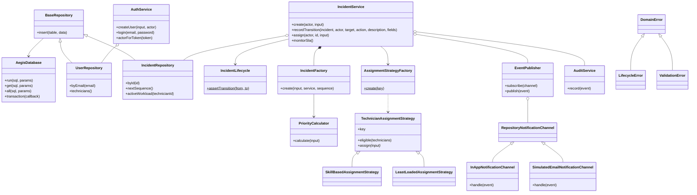

# UML class diagram

Runtime classes are in `backend/src/domain.js`, `backend/src/services.js`, and `backend/src/database.js`. Incident DTOs and table associations are mapped in the [ER diagram](ER_DIAGRAM.md).
