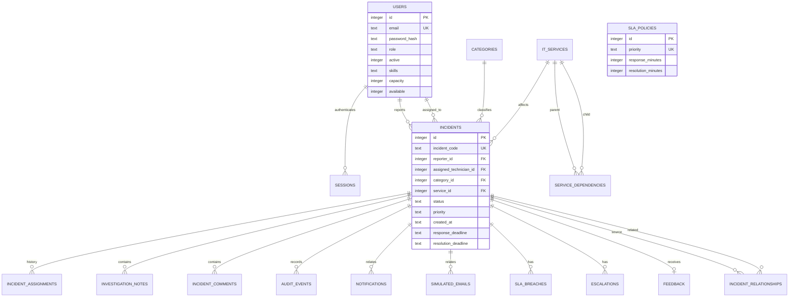

# Entity relationship diagram

The creation service copies the selected SLA policy's targets into the incident row. There is no foreign key to the policy, so a policy edit preserves prior snapshots.
