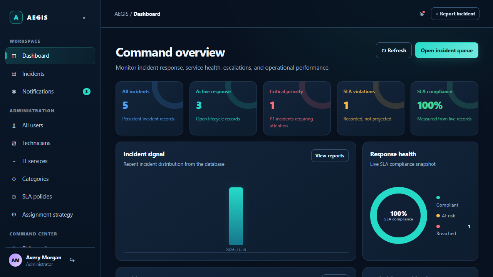
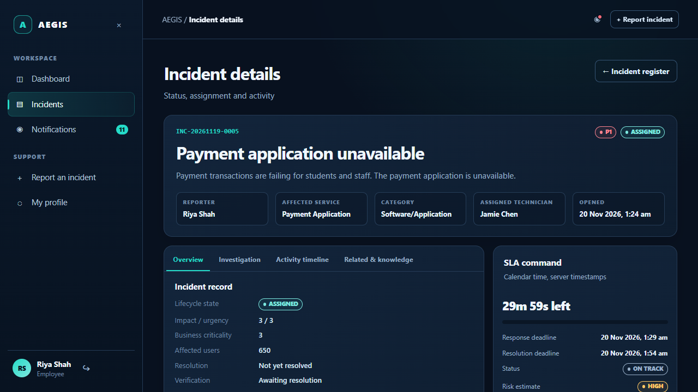

# AEGIS - Intelligent IT Service Management & Incident Resolution System

**Course:** CS F213 / MAC F212 Object-Oriented Programming, Semester I 2026-2027  
**Project type:** local, database-backed academic application  
**Submission context:** source repository and supporting documentation

---

## Executive summary

AEGIS is an Intelligent Incident Command Center for handling the complete IT incident lifecycle: report, classify, prioritise, assign, investigate, resolve, verify, and close. It is designed for organisations that need one traceable place for employees to report disruption, technicians to manage operational work, and administrators to oversee service quality and compliance.

The solution is local-first and database-backed. A browser SPA calls a Node.js 24 REST backend, whose class-based service layer persists data in SQLite. Deterministic intelligence assists rather than replaces people: it calculates explainable priority, proposes categories, identifies possible duplicates, assesses SLA risk, recommends historical resolutions, and raises controlled escalations. No paid AI service is used.

## Problem definition

Informal incident handling makes accountability and learning difficult. A user may send a chat message, a technician may investigate without a record, a deadline may pass unnoticed, and managers may not know whether one foundational service is affecting others. AEGIS addresses this by applying explicit workflow rules, SLA calculations, assignment policies, audit events, and data-derived dashboards.

### Stakeholders

- **Employees:** report incidents, add clarification, follow progress, verify the remedy, and provide feedback.
- **Technicians:** receive eligible work, acknowledge it, investigate, communicate, resolve, and manage workload/deadlines.
- **Administrators / IT managers:** configure services/categories/SLAs, manage accounts, choose assignment policy, oversee escalations, audit, outbox, service health, and reporting.

### Scope and assumptions

The implementation models a single organisation with continuous calendar-time SLAs and a local development database. It does not send real email, integrate a third-party identity provider, or claim to identify root cause automatically. The simulated outbox is intentional: it demonstrates a second real notification mechanism without external credentials.

## Requirements and solution modules

| Requirement area | AEGIS module |
| --- | --- |
| Authentication and roles | Registration restricted to employees; hashed passwords, sessions, server-side RBAC |
| Incident lifecycle | Validated transitions and role/precondition checks |
| Priority | Explainable deterministic P1-P4 calculator |
| Assignment | Strategy-based skill and least-loaded selection plus manual admin reassignment |
| SLA | Editable policies, snapshot deadlines, countdown/risk, warnings, breach events |
| Notification / audit | Event publisher, in-app inbox, simulated email outbox, append-only audit records |
| Intelligence | Duplicate match, category rule suggestion, SLA risk, escalation, historical resolution hints |
| Administration/reporting | Configuration pages, filters, real aggregate reports, workload/service analysis |

Detailed functional and non-functional requirements are in [REQUIREMENTS.md](../requirements/REQUIREMENTS.md); requirement mapping is in [COMPLIANCE_MATRIX.md](../requirements/COMPLIANCE_MATRIX.md).

## Architecture

AEGIS follows a layered monolith:

```text
Browser SPA -> REST controllers -> application services / domain policies -> repositories -> SQLite
                                  -> event publisher -> notifications
                                  -> audit service -> audit table
```

The frontend owns rendering, responsive navigation, validation feedback, and API requests. The backend owns every security-sensitive and business-critical decision. Repositories keep SQL separate from policies; the database persists across restarts. The full diagram and rationale are in [ARCHITECTURE.md](../architecture/ARCHITECTURE.md).

## Technology selection report

1. **Why this programming language?** JavaScript in Node 24 was selected because it is available in the execution environment, supports clear class-based OOP, and keeps client/server data shapes understandable for a semester team.
2. **Why this frontend?** A dependency-free SPA gives a responsive modern UI without requiring a package download or second runtime. Components/routes are organised in code even without a large framework.
3. **Why this backend?** Node's built-in HTTP, crypto, test, and SQLite modules provide a real API, authentication and persistence while preserving reliable offline setup.
4. **Why this database?** SQLite is relational, transactional, file-persistent, portable, and ideal for a local demonstration.
5. **Why this architecture?** Layering makes controllers thin, rules testable, SQL isolated, and patterns easy to demonstrate.
6. **Alternatives considered?** Java/Spring/H2 was preferred by the master prompt but Maven was unavailable locally; React/Vite would add external package installation. A JSON file was rejected because it weakens relational integrity and database evidence.
7. **Advantages and limitations?** The stack is small, portable, and locally reliable, but SQLite and an in-process server are not the target for a large horizontally scaled production deployment.
8. **How does it support OOP?** Classes encapsulate services/repositories, strategy objects provide polymorphism, event listeners demonstrate Observer, a factory creates valid incidents, and domain errors make exceptional cases explicit.
9. **How would it scale?** Move sessions/cache to shared infrastructure, migrate SQLite to PostgreSQL, run stateless API instances behind a load balancer, use an external queue/email provider, add monitoring/rate limits, and centralise identity.

## Object-oriented design and patterns

The project uses encapsulation (controlled lifecycle mutation), abstraction (`PriorityCalculator`, repositories, channels, strategies), composition (services assembled from policies/repositories), associations (users/services/incidents), collections (skills/tokens/timelines), and domain exceptions.

Two central patterns are **Strategy** for interchangeable technician selection and **Observer/event publisher** for two independent notification channels. Services call the audit recorder directly. A factory centralises initial valid incident construction. See [OOP design](../OOP_DESIGN_EXPLAINED.md) and [class diagram](../diagrams/CLASS_DIAGRAM.md).

## Intelligent and automated features

### Explainable priority

The calculator uses impact, urgency, business criticality, affected users, and service context to produce a deterministic score and P1-P4 class. The details view explains its inputs, threshold and reasons, so users can challenge or understand the result.

### Duplicate detection

Input text is normalised, tokenised, stripped of common words and compared with unresolved incidents using a weighted Jaccard-style overlap, category and service bonus. A match is a **possible related incident**, never an automatic merge.

### Category suggestion and SLA risk

Category rules expose their matching words (for example VPN/DNS -> Network). SLA risk considers remaining deadline, acknowledgement/assignment state, stage and priority. It clearly labels a heuristic risk separately from a persisted breach.

### Escalation and Service Pulse

The monitor escalates qualifying overdue/high-risk work once per level and publishes notifications/audit. Service Pulse displays dependency relationships and possible downstream impact; it never presents correlation as proven causation.

## Database design

SQLite tables represent users, technician profiles, services/dependencies, categories, policies, incidents/assignments/notes/comments/relationships, notifications/outbox, audit, SLA events, escalations and feedback. Historical records are retained. The ER diagram and exact constraints are in [SCHEMA.md](../database/SCHEMA.md) and [ER_DIAGRAM.md](../diagrams/ER_DIAGRAM.md).

## Security

- Passwords are salted and hashed; plaintext credentials are never persisted.
- Public registration cannot choose an administrator or technician role.
- Session validation and ownership/role checks happen server-side.
- Request bodies are validated and unknown/invalid state actions fail safely.
- Error responses avoid raw stack traces and sensitive database data.

For a production system, HTTPS-only cookies, CSRF design, rate limiting, audit protection, key management, backup/restore, MFA/SSO, vulnerability management, and operational monitoring are required.

## Testing and results

All 30 automated tests passed. The Edge smoke test exercised three role workflows, mobile navigation, report filters and CSV download. A two-process check confirmed that incident data and its audit trail persisted across a server restart. See [test cases](../testing/TEST_CASES.md) and [test results](../testing/TEST_RESULTS.md).

## Interface screenshots





## Demonstration

The planned presentation follows three complete workflows: employee critical report, technician investigation-to-resolution with employee verification, and administrator intelligence/escalation oversight. Exact accounts and steps are in [DEMO_SCRIPT.md](../demo/DEMO_SCRIPT.md).

## Limitations and future work

AEGIS is intentionally an academic local deployment. It uses calendar-time SLAs, simulated email, rule/heuristic intelligence, and SQLite. Next steps are PostgreSQL and a job queue, true business calendars, production SSO/MFA, attachment storage, richer graph analysis, notification adapters, accessibility testing with users, and deployment observability.

## Conclusion

AEGIS demonstrates how object-oriented design can turn an operational incident process into a maintainable system. Its rules are transparent, its history is persistent, its automation is explainable, and its architecture leaves clear extension points rather than baking every choice into a controller or page.
